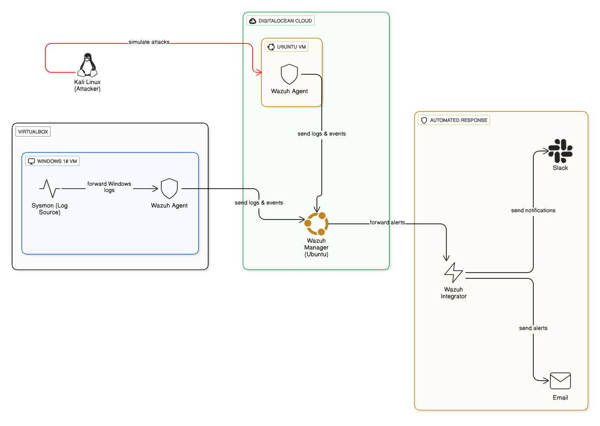
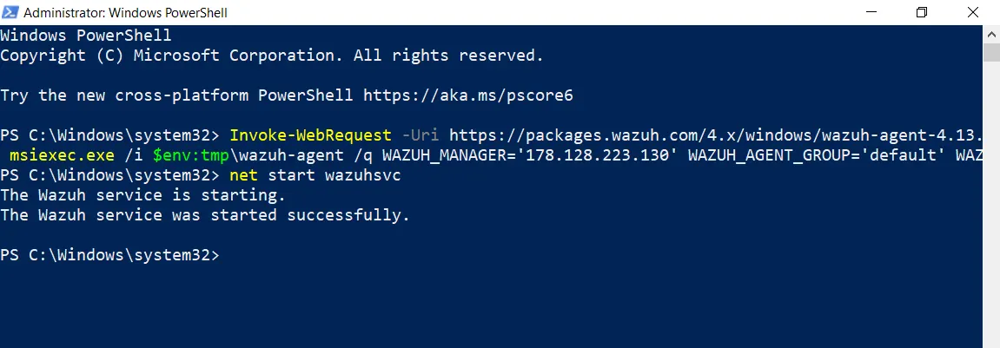
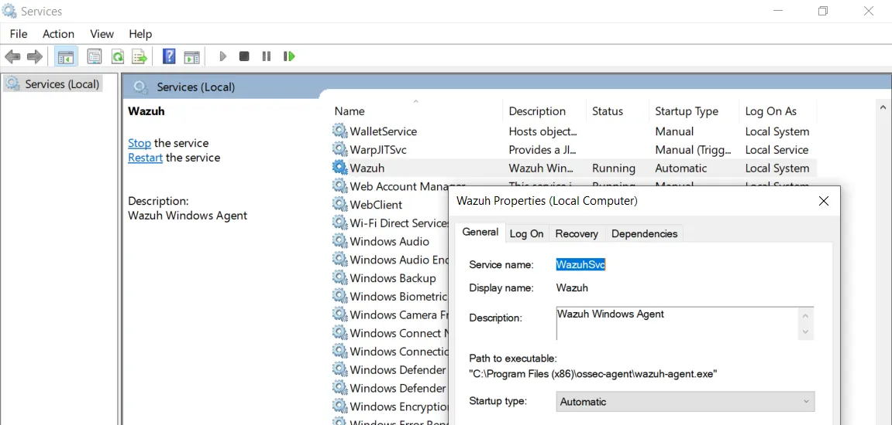
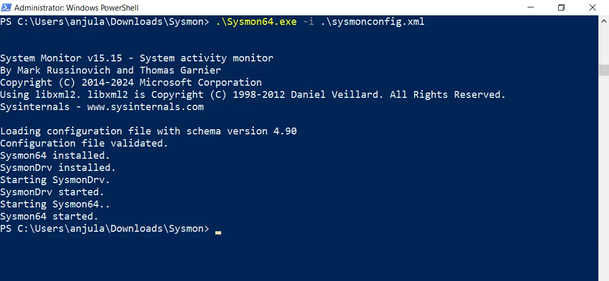

# Cross-Platform Intrusion Detection & Active Threat Response with Wazuh

## Demo


## Summary

This project establishes a powerful, automated security monitoring system using **Wazuh** across virtualized **Windows 10** (with **Sysmon** for deep logging) and **Ubuntu** servers.

The core **workflow** is automated from detection to notification: Wazuh agents collect diverse logs and forward them to the **Wazuh Manager**. The manager analyzes this data, identifies critical threats (e.g., brute force, malware activity via Sysmon events), and automatically generates high-level alerts. Using the **Wazuh Integrator**, the system instantly forwards these critical alerts via both **Slack** and **Email** to security personnel, ensuring immediate and multi-channel incident notification for rapid response.

## Lab overview




## Utilities used

- [DigitalOcean](https://cloud.digitalocean.com/droplets/) [ 2x Ubuntu 24.04 Droplets ]
- Oracle Virtualbox [ Windows 10 VM ]
- Termius - for SSH session mgmt

---

## Setup Wazuh Manager

### Install Wazuh Manager

- Docs: [https://documentation.wazuh.com/current/quickstart.html](https://documentation.wazuh.com/current/quickstart.html)

```bash
curl -sO https://packages.wazuh.com/<latest>/wazuh-install.sh && sudo bash ./wazuh-install.sh -a
```

Copy the username and password for Wazuh login.

If you forgot the password run this command:

```bash
sudo tar -O -xvf wazuh-install-files.tar wazuh-install-files/wazuh-passwords.txt
```

Allow firewall port 443 & Check the status:

```bash
ufw allow 443
systemctl status wazuh-manager.service
```

If not running:

```bash
systemctl restart wazuh-manager.service
```


---

## Setup Wazuh agent on Windows

Click “Deploy new agent” and select Windows MSI 32/64 bit version.


Copy the “Invoke-WebRequest” command & Run in Administrator Powershell on Windows10 VM.

Start the Wazuh agent:

```powershell
net start wazuhsvc
```



Allow port 1515 & 1514 on Wazuh server:

```bash
ufw allow 1515
ufw allow 1514
```




---

## Setup Wazuh agent on Ubuntu

Deploy new agent and select Linux DEB amd64 version.


Copy the “wget” command & Run on terminal.


Start the Wazuh agent:

```bash
sudo systemctl daemon-reload
sudo systemctl enable wazuh-agent
sudo systemctl start wazuh-agent
```

Check the status:

```bash
sudo systemctl status wazuh-agent
```


---

## Configure Windows agent

## Setup Sysmon

- Download Sysmon: [https://learn.microsoft.com/en-us/sysinternals/downloads/sysmon](https://learn.microsoft.com/en-us/sysinternals/downloads/sysmon)

- Get sysmon config: https://github.com/olafhartong/sysmon-modular

### Install Sysmon

```bash
.\Sysmon64.exe -accepteula -i sysmonconfig.xml
```



---

## Configure Ubuntu agent

Ensure that the Wazuh agent is properly configured to communicate with the Wazuh server (Check the IP of Wazuh):

```bash
 nano /var/ossec/etc/ossec.conf
```


Restart the agent if any changes were done.

```bash
sudo systemctl restart wazuh-agent
```