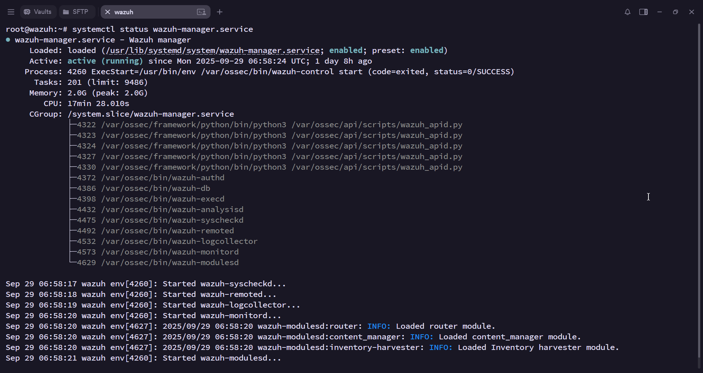
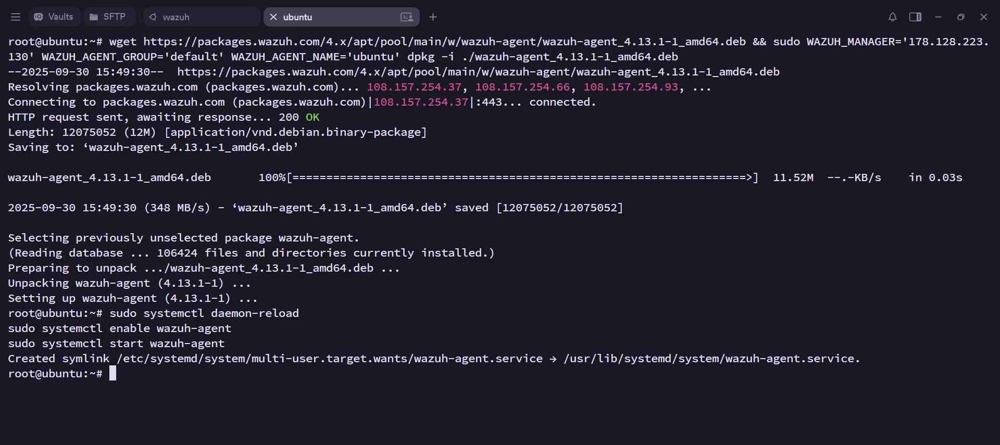
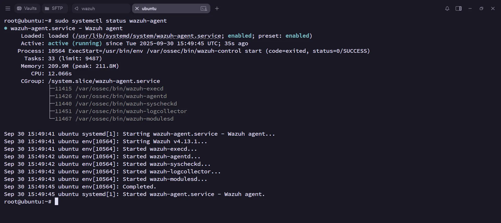

# Cross-Platform Intrusion Detection & Active Threat Response with Wazuh

## Demo

## Summary

This project establishes a powerful, automated security monitoring system using **Wazuh** across virtualized **Windows 10** (with **Sysmon** for deep logging) and **Ubuntu** servers.

The core **workflow** is automated from detection to notification: Wazuh agents collect diverse logs and forward them to the **Wazuh Manager**. The manager analyzes this data, identifies critical threats (e.g., brute force, malware activity via Sysmon events), and automatically generates high-level alerts. Using the **Wazuh Integrator**, the system instantly forwards these critical alerts via both **Slack** and **Email** to security personnel, ensuring immediate and multi-channel incident notification for rapid response.

## Lab overview


## Utilities used

- [DigitalOcean](https://cloud.digitalocean.com/droplets/) [ 2x Ubuntu 24.04 Droplets ]
- VMWare [ Windows 10, Kali VMs ]
- Termius - for SSH session mgmt

---

# Initial Steps

## Setup Wazuh Manager

### Install Wazuh Manager

- Docs: [https://documentation.wazuh.com/current/quickstart.html](https://documentation.wazuh.com/current/quickstart.html)

```bash
curl -sO https://packages.wazuh.com/<latest>/wazuh-install.sh && sudo bash ./wazuh-install.sh -a
```

Copy the username and password for Wazuh login.

If you forgot the password run this command:

```bash
sudo tar -O -xvf wazuh-install-files.tar wazuh-install-files/wazuh-passwords.txt
```

Allow firewall port 443 & Check the status:

```bash
ufw allow 443
systemctl status wazuh-manager.service
```

If not running:

```bash
systemctl restart wazuh-manager.service
```



Login to Wazuh dashboard.


---

## Setup Wazuh agent on Windows

Click “Deploy new agent” and select Windows MSI 32/64 bit version.


Copy the “Invoke-WebRequest” command & Run in Administrator Powershell on Windows10 VM.

Start the Wazuh agent:

```powershell
net start wazuhsvc
```


Allow port 1515 & 1514 on Wazuh server:

```bash
ufw allow 1515
ufw allow 1514
```


---

## Setup Wazuh agent on Ubuntu

Deploy new agent and select Linux DEB amd64 version.


Copy the “wget” command & Run on terminal.



Start the Wazuh agent:

```bash
sudo systemctl daemon-reload
sudo systemctl enable wazuh-agent
sudo systemctl start wazuh-agent
```

Check the status:

```bash
sudo systemctl status wazuh-agent
```




---

## Configure Ubuntu agent

Ensure that the Wazuh agent is properly configured to communicate with the Wazuh server (Check the IP of Wazuh):

```bash
 nano /var/ossec/etc/ossec.conf
```


Restart the agent if any changes were done.

```bash
sudo systemctl restart wazuh-agent
```

### Adding Wazuh manager rule to trigger on expected events

Navigate and edit the ossec.conf file on Wazuh manager:

```powershell
 nano /var/ossec/etc/ossec.conf
```

Add following active-response rule:

- This configuration suggests that when a rule with ID 5710 is triggered, the firewall will drop the corresponding traffic for a duration of 10 minutes. It's a common approach for dealing with potential threats or suspicious activity.

```xml
<active-response>
  <command>firewall-drop</command>
  <location>local</location>
  <rules_id>5710</rules_id>
  <timeout>600</timeout>
</active-response>
```


Restart Wazuh mgr.

```bash
sudo systemctl restart wazuh-manager.service
```

### Using Hydra to perform a bruteforce attack on Ubuntu VM

- Download hydra from Github: https://github.com/vanhauser-thc/thc-hydra.git

Ping Ubuntu VM IP from Kali.

```bash
ping <ubuntu vm public ip>
```


Execute a bruteforce SSH attack using Hydra.

```bash
sudo hydra -l <username> -P <passlist.txt> ssh://<ubuntu vm ip address>
```

In this case:

```bash
sudo hydra -l root -P /usr/share/wordlists/rockyou.txt ssh://139.59.126.244
```


SSHd Failed login attempts and Host firewall-drop events recorded


Try pinging Ubuntu VM again.


